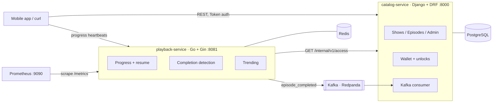

# PocketCast

Backend for an episodic audio-series app (in the style of Pocket FM): shows and episodes, coin-based episode unlocks, listening progress with resume, and a trending leaderboard.

It's two services: **Django** for the catalog and the money, **Go** for the high-traffic playback path. They talk over HTTP and **Kafka**.

> Backend only: there is no frontend. You use it through the REST API (curl or Postman) and the Django admin. For a full walkthrough, see **[PROJECT.md](PROJECT.md)**.

## Features
- Shows and episodes managed in the Django admin. Free and paid episodes, with `audio_url` hidden until an episode is unlocked.
- A coin wallet with an append-only ledger and idempotent top-ups.
- Episode unlocks that can't double-charge, even under concurrent requests (PostgreSQL row locks).
- Progress heartbeats, resume position and "continue listening", stored in Redis.
- Exactly-once episode-completion events to Kafka, read by an idempotent consumer.
- A trending leaderboard over a rolling 7-day window, using Redis sorted sets.
- Prometheus metrics, structured logs, graceful shutdown and GitHub Actions CI.

## Architecture



## Tech stack
| | |
|---|---|
| catalog-service | Python 3.12, Django 5.2, Django REST Framework, PostgreSQL 16+, kafka-python, Gunicorn |
| playback-service | Go 1.26, Gin, go-redis, segmentio/kafka-go, Prometheus client |
| Infra | Docker Compose, Redis 7, Redpanda (Kafka API), Prometheus, GitHub Actions |

## Quick start (Docker)

You need Docker with Compose v2.23+ (Docker Desktop, or Colima on macOS).

```bash
git clone https://github.com/harshyadav21/pocketcast.git && cd pocketcast
docker compose up -d --build        # or: make up
python3 scripts/e2e_test.py         # 17 end-to-end checks, should print ALL PASSED
```

| Service | URL |
|---|---|
| Catalog API | http://localhost:8000/api/v1/shows |
| Django admin | http://localhost:8000/admin (`docker compose exec catalog python manage.py createsuperuser`) |
| Playback API | http://localhost:8081/v1/trending |
| Prometheus | http://localhost:9090 |
| Postgres (from host) | `localhost:5433`, user/password/db `pocketcast` |

Stop with `docker compose down`. Add `-v` to also delete the database volume.

To run the services directly on your machine against a locally installed PostgreSQL, see [PROJECT.md → Run locally](PROJECT.md#6-run-locally-without-docker-for-the-apps).

## API summary

**catalog-service** (`Authorization: Token <token>`)

| Method | Path | Result |
|---|---|---|
| POST | `/api/v1/auth/register` | `201` `{user_id, token}` |
| POST | `/api/v1/auth/token` | `200` `{token}` |
| GET | `/api/v1/shows?genre=&language=` | Paginated list |
| GET | `/api/v1/shows/{slug}` | Show with episodes, each with `locked` and `audio_url` |
| GET | `/api/v1/episodes/{id}` | Episode |
| POST | `/api/v1/episodes/{id}/unlock` | `201` charged · `200` already unlocked · `402` not enough coins · `400` free episode |
| GET | `/api/v1/wallet` · `/api/v1/wallet/transactions` | Balance · ledger |
| POST | `/api/v1/wallet/top-up` | `201` credited · `200` retry of the same `payment_ref` · `409` same ref, different amount |
| GET | `/internal/v1/access?user_id=&episode_id=` | Service-to-service (`X-Internal-Token` header) |

**playback-service** (`X-User-ID` header, which an API gateway would set after auth)

| Method | Path | Result |
|---|---|---|
| POST | `/v1/progress` `{episode_id, position_seconds}` | `200` `{completed}` · `403` locked · `404` unknown · `422` past the end |
| GET | `/v1/progress/{episodeID}` | Resume position |
| GET | `/v1/continue-listening?limit=` | Recently played |
| GET | `/v1/trending?limit=` | Shows ranked by completions over the last 7 days |
| GET | `/healthz` · `/metrics` | Liveness · Prometheus |

## Testing
```bash
cd playback-service && go test -race ./...                          # Go unit + handler tests
cd catalog-service && POSTGRES_HOST=localhost POSTGRES_PORT=5433 \
  .venv/bin/python manage.py test                                    # Django tests, incl. row-lock concurrency test
python3 scripts/e2e_test.py                                          # end to end: flows, HTTP concurrency, Kafka
```
For manual Kafka testing (watch events, replay a duplicate), see [PROJECT.md → Testing Kafka](PROJECT.md#9-testing-kafka-by-hand).

## Project structure
```
catalog-service/      Django project: catalog app (shows, episodes, consumer), wallet app (coins, unlocks)
playback-service/     Go service: cmd/server (main), internal/{api,progress,catalog,events,metrics,config}
scripts/              e2e_test.py, create_local_db.sql
docs/schema.sql       SQL generated from the Django migrations (reference)
notes/STUDY_GUIDE.md  Code walkthrough and interview Q&A
docker-compose.yml    Full stack · Makefile: shortcuts
```

## Key design decisions
- **No double charge:** the wallet row is locked with `SELECT ... FOR UPDATE` inside a transaction. A unique `(user, episode)` constraint and a unique ledger `reference` back it up.
- **Exactly-once completion:** Redis `SETNX` lets one heartbeat through. If the Kafka publish fails, the marker is cleared so the next heartbeat retries.
- **Idempotent consumer:** the event id is stored in the same DB transaction as the counter update, and the offset is committed after it.
- **Access cache:** only "allowed" answers are cached, so a user who just paid is never blocked by a stale "no".

## Roadmap
- Outbox pattern for catalog-side events
- Rate limiting on heartbeats
- A recommendations consumer on the same topic

## License
MIT
